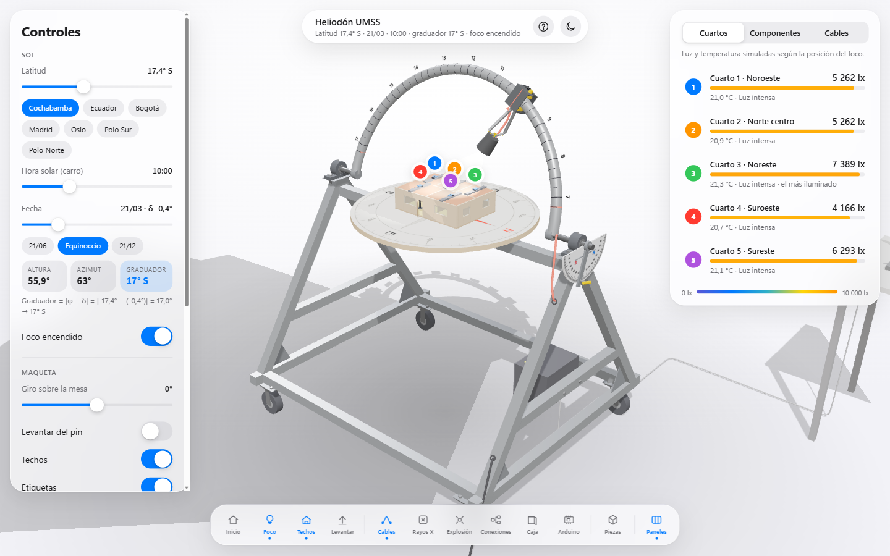
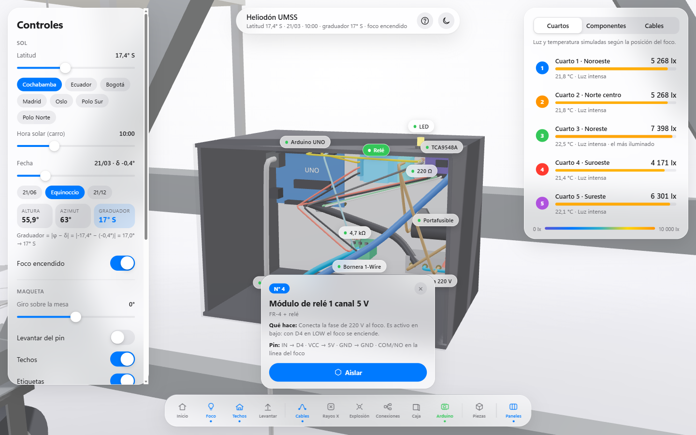
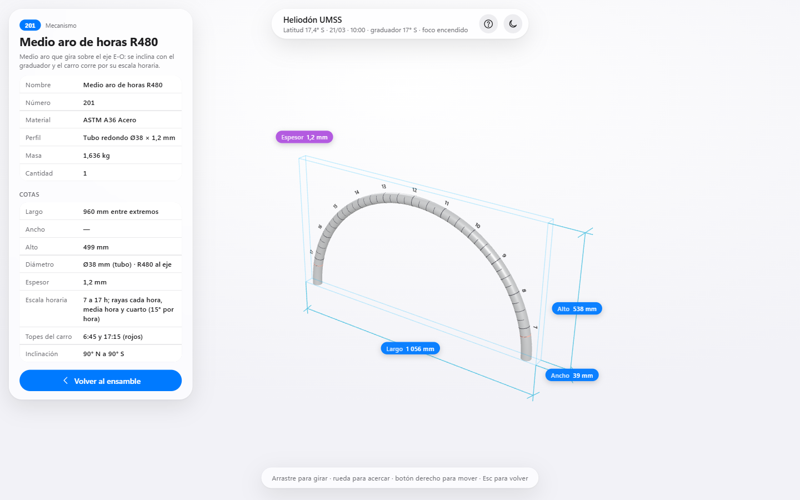
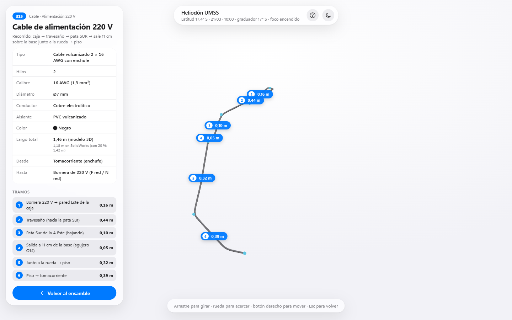
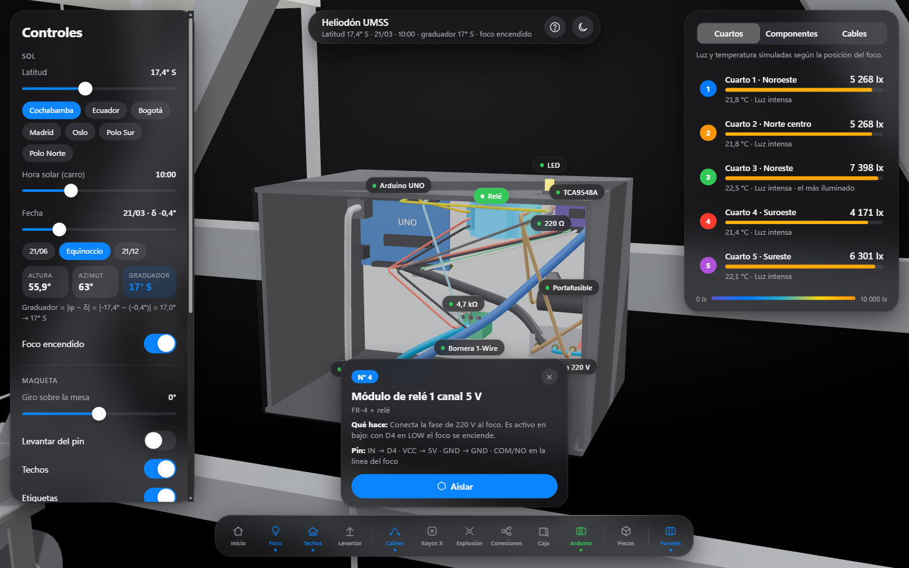

# Simulador 3D del Heliodón UMSS — caballetes en A

Simulador 3D interactivo del heliodón pequeño de la UMSS, con las medidas del ensamble de SolidWorks del 10-11/11/2026.

**Abrir en línea:** https://angelja19.github.io/simulador-3d-heliodon/

También funciona sin internet: descargue el repositorio y abra `index.html` con doble clic. Instrucciones en `LEEME.txt`.

## Qué tiene

- **Estructura en A** de 120 × 105 × 90 cm en tubo galvanizado 40 × 40 × 1,2: una A en cada extremo, tubo superior Este-Oeste y dos tubos inferiores; el centro queda libre. 4 ruedas Ø100 (2 con freno).
- **Medio aro R480** en tubo Ø38 × 1,2 con la escala horaria (rayas cada hora, media hora y cuarto; números de 7 a 17), el carro con su **índice rojo**, el arco de declinación y el foco.
- **Graduador** por fuera de la A Este: inclinación del aro = **|φ − δ| redondeado a 1°** (Cochabamba en el equinoccio: 17° S).
- **Mesa Ø700** con rosa de los vientos y maqueta de 5 cuartos con sensores DS18B20 y BH1750.
- **Caja del Arduino** en el travesaño de la A Este; cables por dentro de los tubos: sensores por la pata Norte (azul), foco y 220 V por la pata Sur (rojo y negro).

| Arduino por dentro | Aislar una pieza | Aislar un cable |
|---|---|---|
|  |  |  |

## Cómo se usa

- **Barra de abajo:** Inicio, Foco, Techos, Levantar, Cables, Rayos X, Explosión, Conexiones, Caja, **Arduino**, **Piezas** y Paneles.
- **Piezas:** al pasar el mouse cada pieza se resalta con su nombre, número y material. Al tocarla aparece **Aislar**: la pieza queda sola en el centro, girable y con zoom, con sus cotas y una tarjeta (material, perfil, masa y cantidad). **Volver** (o Esc) regresa.
- **Cables:** cualquier cable (también los de la caja del Arduino) se aísla con su tipo, hilos, calibre AWG, diámetro, materiales, color, largo total, desde y hasta, y la cota de cada tramo.
- **Arduino:** la cámara se acerca a la caja, la tapa se vuelve transparente y cada componente dice qué hace y a qué pin va (relé D4, LED D8, DS18B20 en D2 con 4,7 kΩ).
- **Controles:** latitud, hora solar (carro), fecha con 21/06, Equinoccio y 21/12, foco, giro de la maqueta, levantar, techos, etiquetas y la sección **Simulación** (sensor de temperatura y de luz; apagados muestran «—»).
- **Panel derecho:** Cuartos, Componentes (todas las piezas por grupo) y Cables.
- Modo claro y oscuro. Si la PC va lenta, la calidad de las sombras baja sola.

Pruebas con el MCP de Playwright: `capturas/resultado_prueba_mcp_heliodonA.txt` (68 de 68 OK, consola sin errores).

Usa [three.js](https://threejs.org) r147 (licencia MIT, copia en `lib/`).
